<h1 align="center">Metrics Dashboard Design</h1>

<p align="center">
  A Claude Code skill that builds calm, honest product analytics dashboards.<br>
  Website → download → install → trial → paid, on one page — checked on real screenshots before it calls a job done.
</p>

<p align="center">
  <a href="#quick-start">Quick start</a> ·
  <a href="#the-example">The example</a> ·
  <a href="#what-it-gets-right">What it gets right</a> ·
  <a href="#whats-inside">What's inside</a> ·
  <a href="#principles">Principles</a> ·
  <a href="#contributing">Contributing</a>
</p>

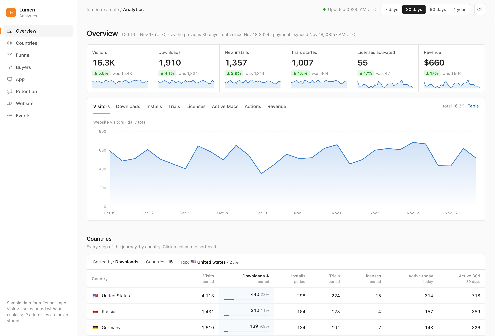

## Overview

**Metrics Dashboard Design** gives your coding agent a tested blueprint for the page every indie developer and small
SaaS ends up building: *is it growing, where do people drop off, and who actually pays?*

It covers the whole page — a Cloudflare-style frame with a sidebar and a sticky top bar, a hairline KPI row with
deltas and sparklines, metric tabs over one chart with a table toggle, a sortable countries table, a funnel that
separates website events from app cohorts, buyer journeys with timelines, retention cohorts, app health, traffic
sources and an event log — plus the parts that usually go wrong: **numbers that disagree**, **revenue that lags**,
**guesses shown as facts**, and **tracking that quietly becomes surveillance**.

It was distilled from the analytics dashboard of [TypeCorrect](https://typecorrect.com/?utm_source=github&utm_campaign=metrics-dashboard-design-skill),
a shipped Mac app, and from every bug its owner caught on a screenshot. The
[case study](skills/metrics-dashboard-design/references/case-study-typecorrect.md) lists them.

## Quick start

In Claude Code:

```
/plugin marketplace add boburjonmavlonov/metrics-dashboard-design-skill
/plugin install metrics-dashboard-design@metrics-dashboard-design-skill
```

Then open your project and ask:

```
Build an analytics dashboard for this app: visitors, downloads, trials, sales by country, and where buyers came from.
```

The skill also triggers on its own when you work on a stats page or ask why a dashboard's numbers don't add up.

## From the author

<table>
<tr>
<td width="360"><a href="https://typecorrect.com/?utm_source=github&utm_campaign=metrics-dashboard-design-skill">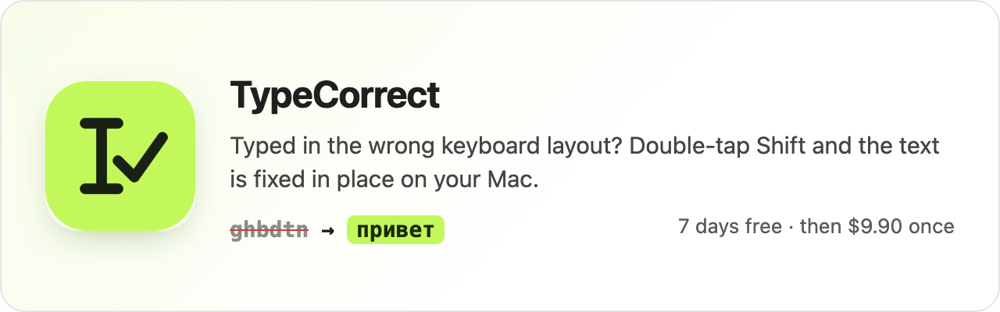</a></td>
<td>

**[TypeCorrect](https://typecorrect.com/?utm_source=github&utm_campaign=metrics-dashboard-design-skill)** fixes text
typed in the wrong keyboard layout on your Mac. Typed `ghbdtn` instead of `привет`? Double‑tap Shift and the word
— or your selection — is fixed right where you typed it, and the layout switches. Turn on Smart switch and wrong
words are fixed as you press Space. Native, private, any two layouts.

7 days free, no card. Then **$9.90 once**, no subscription.

</td>
</tr>
</table>

This skill exists because TypeCorrect needed a dashboard; the example is that dashboard with made-up data.

## The example

[`examples/product-analytics.html`](examples/product-analytics.html) is a complete dashboard in one HTML file, no
dependencies, fed by [`examples/sample-data.js`](examples/sample-data.js) — a year of made-up data for *Lumen*, a
fictional Mac app. Open it in a browser:

```bash
git clone https://github.com/boburjonmavlonov/metrics-dashboard-design-skill
open metrics-dashboard-design-skill/examples/product-analytics.html
```

Every number is computed outside the page by [`examples/sample-data.mjs`](examples/sample-data.mjs) from one daily
series, so totals, country columns, funnel steps and buyer summaries agree; the page only formats them. URL
options for docs and screenshots: `?days=90&theme=dark&metric=revenue&only=funnel&open=1`.

| | |
|---|---|
| 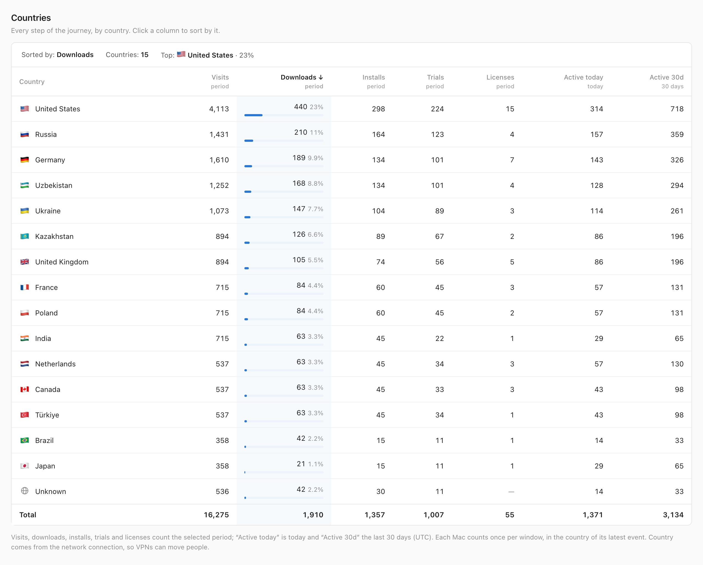 | 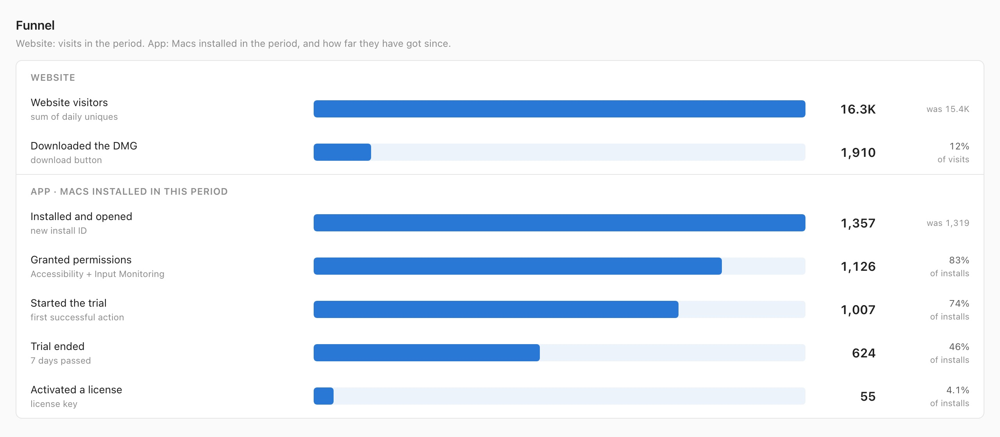 |
| **Countries** — the whole journey per country; each column says its window; the sorted column carries the share. | **Funnel** — website events, then the cohort of Macs installed in the period, each with its own base. |
| 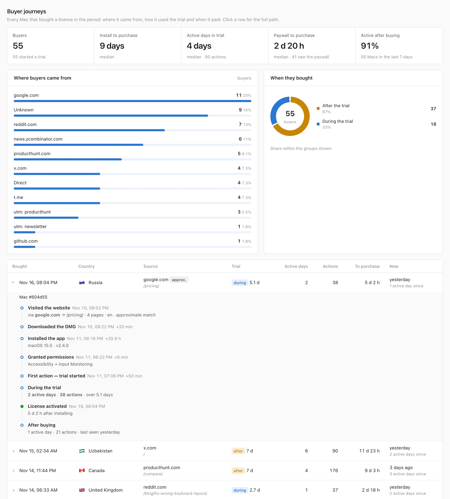 | 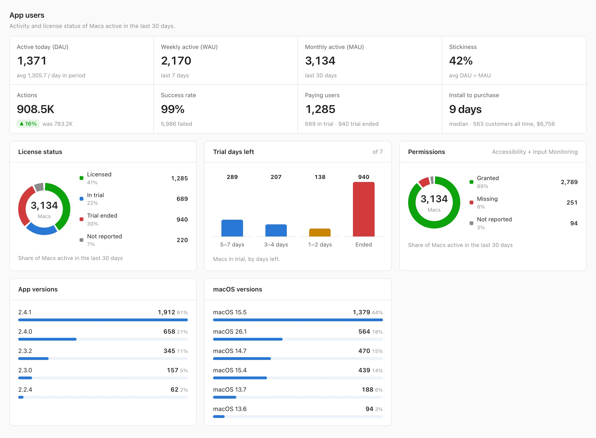 |
| **Buyer journeys** — where each buyer came from, how they used the trial, every step with its gap. Unsure matches say `approx.` | **App users** — DAU/WAU/MAU, license status and permissions with a grey *Not reported* slice, trial days left, versions. |
| 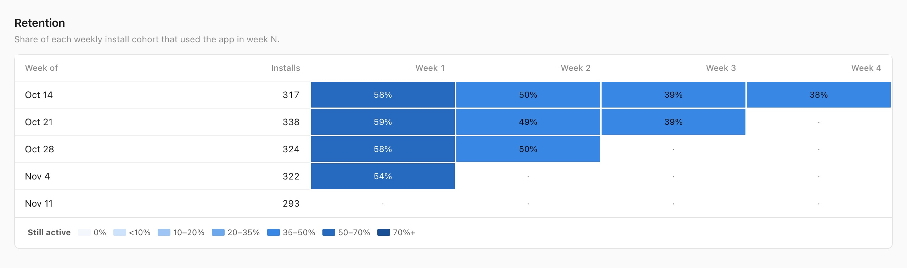 | 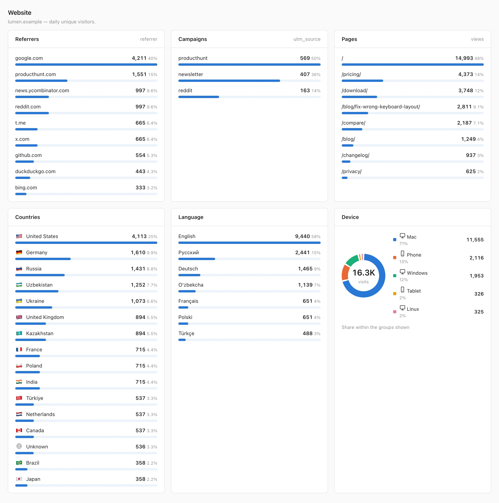 |
| **Retention** — weekly install cohorts in seven classed tiers; future weeks are a dot, not 0%. | **Website** — referrers, campaigns, pages, countries, languages, devices. |

<p align="center">
  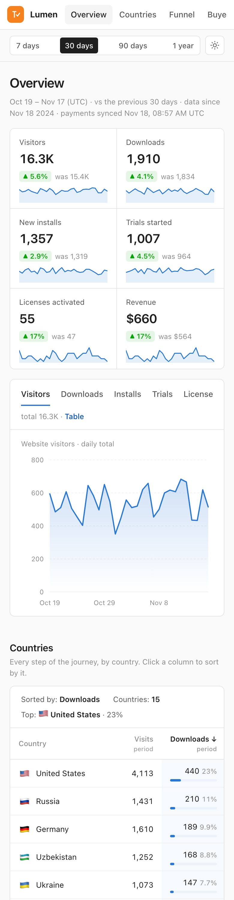
  &nbsp;&nbsp;
  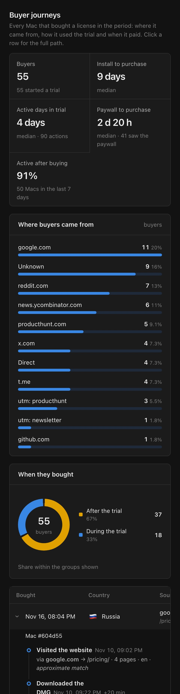
</p>

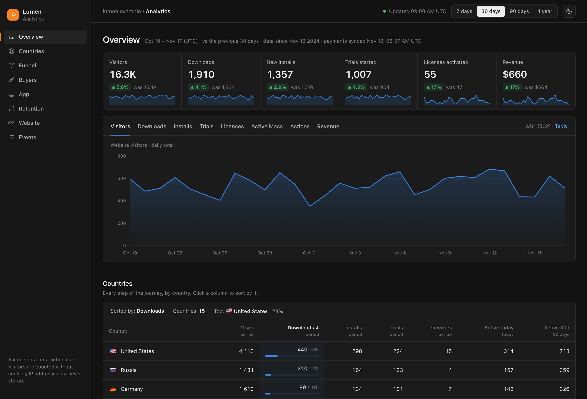

## What it gets right

| Instead of | The agent builds |
|---|---|
| A percentage alone: `+100%` | A delta with its baseline: `▲ 100%` grey, `was 1` — and green only when the base is big enough to mean something |
| `−100%` when there was nothing before | `new` |
| Revenue = sales × price, synced hourly | Net revenue from the payment provider, synced on load and on each sale, with "payments synced 08:57 UTC" in the header |
| $0 coupon orders counted as customers | Sales and customers only where `amount − refunded > 0` |
| "Visitors: 16.3K" for a month of cookie-free counts | "Visitors — sum of daily uniques", because daily hashes can't be de-duplicated across days |
| One funnel mixing events and cohorts | Website steps as events; app steps as a cohort of this period's installs, each with its own base |
| A buyer's source picked from several candidates | `exact`, `approx.` (tagged) or `Unknown`, shown as a row |
| A donut that drops users who didn't report | A grey *Not reported* slice over the whole population |
| A country table with one hidden window | A window under every column: period, today, 30 days |
| Hairlines faked with a grey grid gap (a grey hole when a row is short) | Per-cell inset hairlines |
| `grid-template-columns: 1fr` that pushes the phone layout sideways | `minmax(0, 1fr)` and tables that scroll inside their card |
| Eight charts, one per metric | One chart, metric tabs, and the exact numbers behind a Table toggle |

## Install

### Claude Code plugin

```
/plugin marketplace add boburjonmavlonov/metrics-dashboard-design-skill
/plugin install metrics-dashboard-design@metrics-dashboard-design-skill
```

### Plain skill

```bash
git clone https://github.com/boburjonmavlonov/metrics-dashboard-design-skill
cp -r metrics-dashboard-design-skill/skills/metrics-dashboard-design ~/.claude/skills/
```

### Other agents

Codex, Cursor and any agent that reads Markdown: point your `AGENTS.md` or rules file at
`skills/metrics-dashboard-design/SKILL.md`. The references load from there.

## Usage

| You ask | You get |
|---|---|
| "Build an analytics dashboard for this app: visitors, downloads, trials, sales by country." | A data contract first, then the page built to the references, then screenshots at 1440 / 1024 / 390 in light and dark |
| "Why does the dashboard say $35 when Stripe says $40?" | The honesty checklist run against your code: sync timing, refunds, free orders, windows |
| "Add buyer journeys: where buyers came from and how they used the trial." | A privacy-safe join between website and app, and an expandable timeline per buyer |
| "Review this dashboard." with a screenshot or URL | A verdict, then numbers that disagree, honesty and privacy issues, layout issues, and what works |

## What's inside

```
skills/metrics-dashboard-design/
├── SKILL.md                    the six steps, rules that apply everywhere, house style, critique format
└── references/
    ├── metrics.md              data contract, windows, uniques, deltas, revenue, funnels, attribution, shares, cohorts
    ├── layout.md               frame, section order, grids, breakpoints, phone rules, dark mode
    ├── components.md           KPI row, metric tabs and chart, countries table, funnel, buyer journeys,
    │                           app health, retention heatmap, website cards, event log, states, accessibility
    ├── tokens.md               light and dark colour tokens, type, shape and spacing
    ├── snippets.md             formats, delta, nice axis steps, buckets, sparkline, hairline row, donut,
    │                           bar list, heatmap tiers, flags, scroll spy, freshness on load
    ├── privacy.md              cookieless visitors, daily salts, install IDs, joining website and app, what never to collect
    ├── qa.md                   known totals, screenshot matrix, smell table, accessibility spot checks
    └── case-study-typecorrect.md   the real dashboard this came from, and the bug behind each rule
examples/
├── product-analytics.html      the full dashboard, one file, no dependencies
├── sample-data.mjs             generates the made-up data (deterministic)
└── sample-data.js              the generated data
tools/
├── screenshots.sh              re-takes every image in docs/images with headless Chrome
├── phone-frame.html            390 px frame for phone screenshots
└── typecorrect-card.html       source of the "From the author" card
```

## Principles

- **First glance.** The overview answers "is it growing?" without scrolling.
- **Journey order.** Sections follow the customer: overview, countries, funnel, buyers, app, retention, website, events.
- **Honest.** One number, one field; every window stated; estimates say they are estimates; unknowns are rows.
- **Private.** Counts, not people: no cookies, no stored IPs, no user content, an opt-out.
- **Quiet.** One series colour; green and red only for better and worse; hairlines, not shadows.
- **Checked on screenshots.** Light and dark, phone to desktop, every period, totals compared with numbers
  computed outside the page.

## Re-taking the screenshots

```bash
cd metrics-dashboard-design-skill
python3 -m http.server 4340 &
sh tools/screenshots.sh
```

Needs Google Chrome and macOS `sips`. To change the data, edit `examples/sample-data.mjs` and run
`node examples/sample-data.mjs`.

## Contributing

Issues and pull requests are welcome. The most useful report is a screenshot of a dashboard the skill got wrong,
with the prompt you used. Rule changes should name the screen or bug that motivates them, the way the case study
does.

## Credits

The example's data is made up; *Lumen* and `lumen.example` are fictional (`.example` is a reserved domain). Product names in the references are
mentioned for illustration only, with no affiliation.

## License

[MIT](LICENSE)
