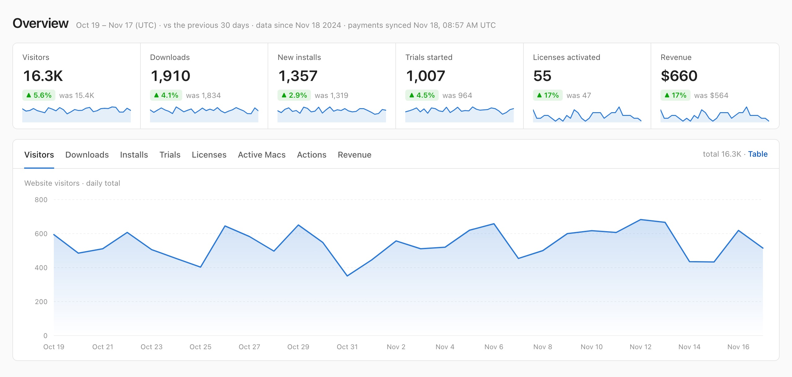
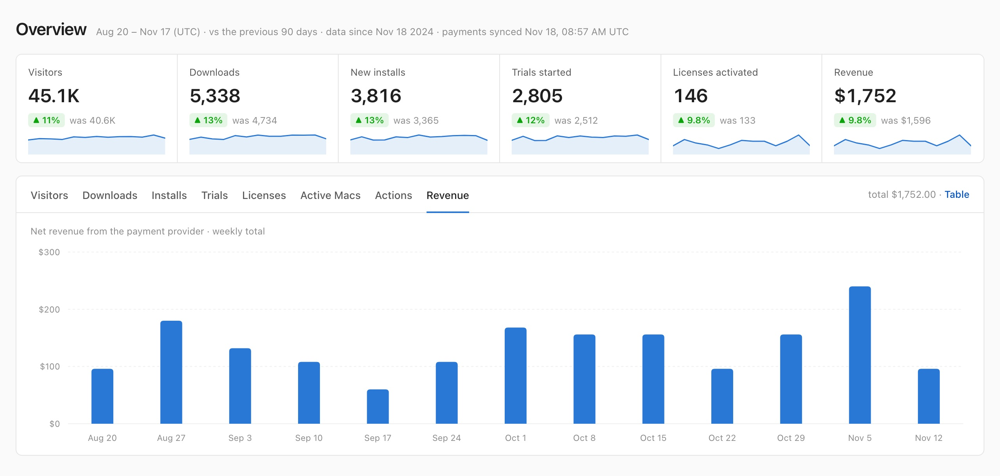
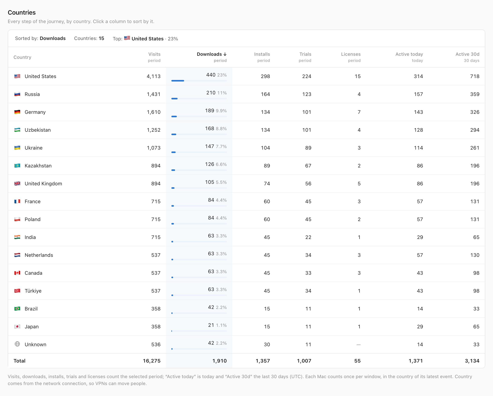
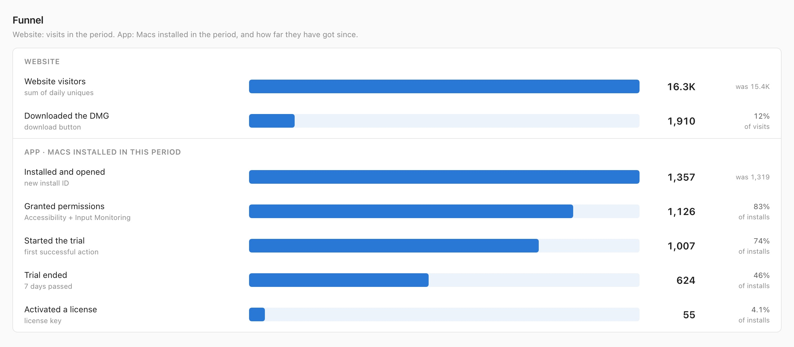
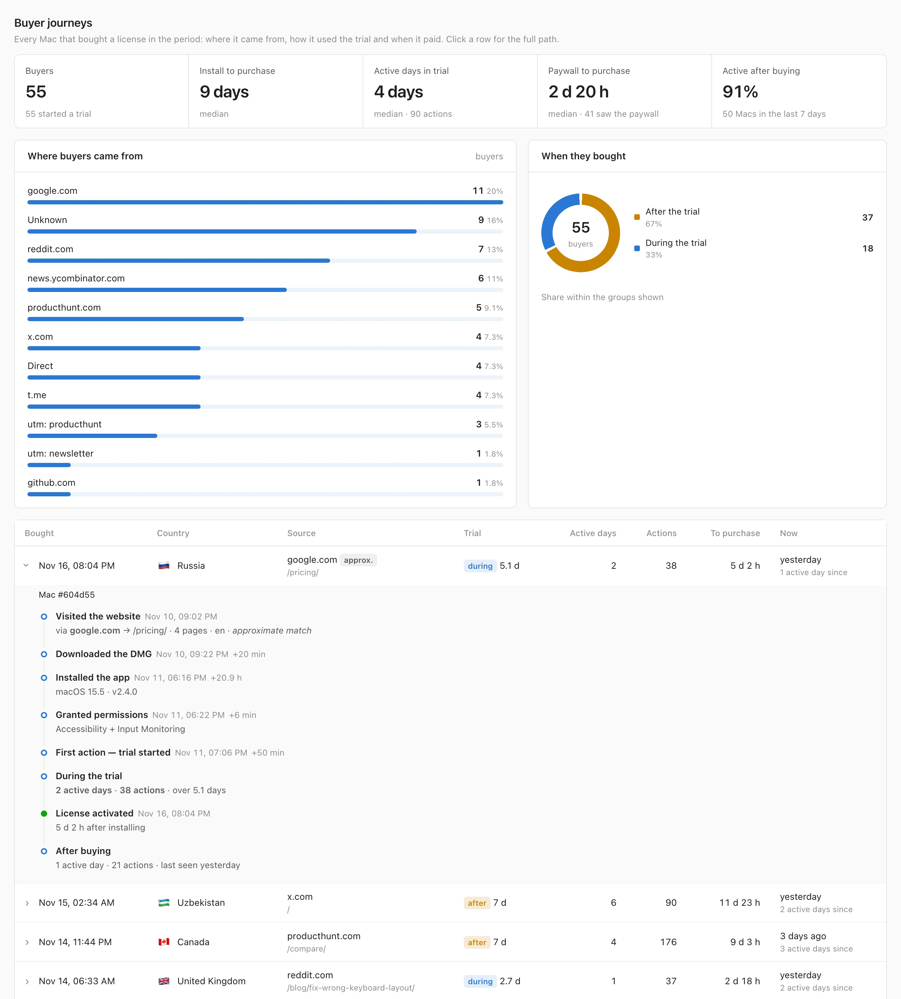
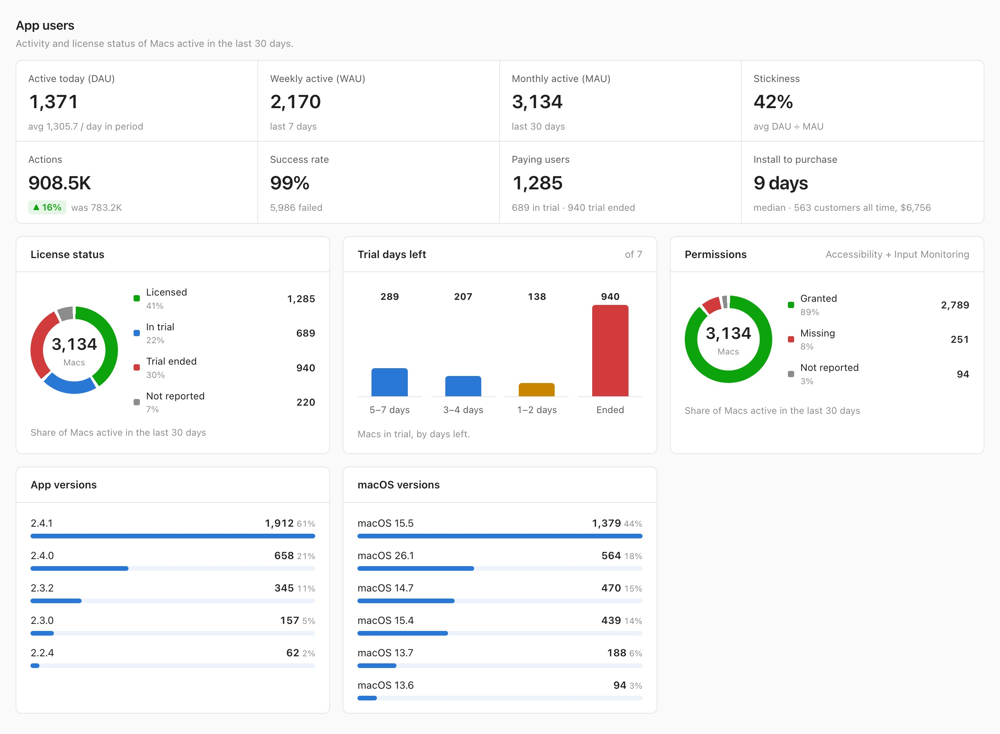
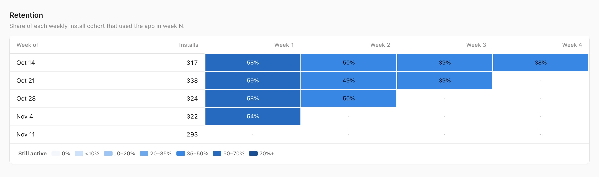
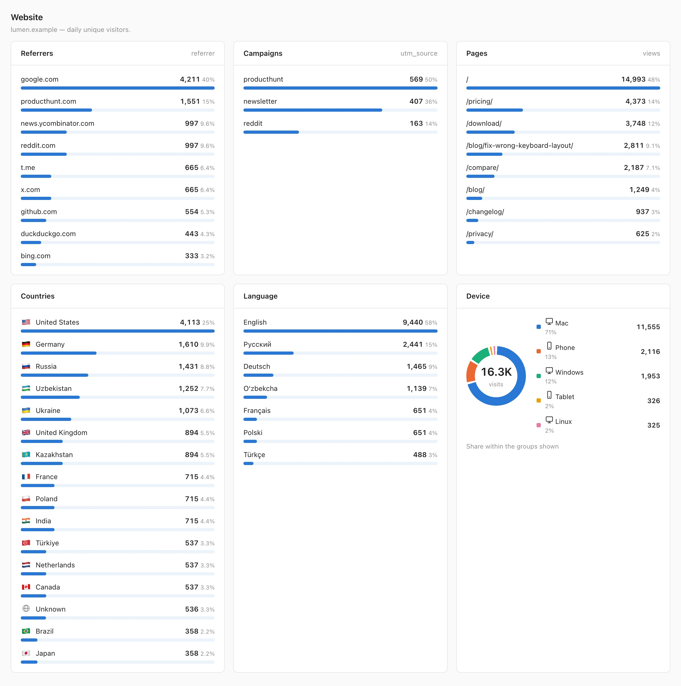

# Components

Every component below is in [`examples/product-analytics.html`](../../../examples/product-analytics.html). Code
for the non-obvious parts is in [snippets.md](snippets.md).

## KPI row

One card split into cells by 1 px hairlines. Each cell: label (12.5 px, `--ink-2`), value (24 px, 600,
tabular), a sub line with the delta pill and "was N", and a 28 px sparkline.

- **Hairlines:** each cell draws an inset left and top line and is pulled 1 px up and left
  (`margin: -1px 0 0 -1px`); the card's `overflow: hidden` clips the lines on its edges. Don't fake hairlines
  with `gap: 1px` on a grey background: when the last row is short (5 tiles in 2 or 3 columns), the empty slot
  shows as a grey block.
- **Delta pill:** `▲ 5.6%` on a green wash, `▼ 23%` on a red wash, grey for zero, tiny bases and "new". See
  the table in [metrics.md](metrics.md#deltas).
- **Sparkline:** same window and buckets as the chart below it, filled with `--series-wash` and stroked with
  `--series` at 1.5 px, `vector-effect: non-scaling-stroke` so it stays crisp when stretched.
- **Hint instead of delta:** tiles without a comparison (DAU, stickiness) show a short hint in the sub line:
  "last 7 days", "avg DAU ÷ MAU", "median".

## Metric tabs over one chart

Underline tabs pick which metric the chart shows; the card head's right side shows the period total ("total
16.3K", "avg 1,306 / day" for DAU) and a **Table** toggle.

- One chart, not eight. The tabs are the legend.
- A context line above the plot says what is drawn and how it's grouped: "Website visitors · daily total",
  "Daily active Macs · weekly average".
- Bars for counts, a line for averages (DAU), an area for visitors. Bars have 4 px rounded tops and are at most
  28 px wide.
- **Buckets:** ≤ 30 days → daily, ≤ 90 → weekly, longer → monthly. Sums for counts, averages for DAU.
- **Axis:** four or five gridlines at nice steps (1, 2, 5 × 10ⁿ), dashed except the baseline; labels in money
  format on the revenue tab. X labels at least 65 px apart.
- **Hover and keyboard:** a dashed crosshair, a dot on lines, a tooltip with the bucket label, the value and the
  metric. The plot is focusable; ← → move between points and update its `aria-label`.
- **Table toggle:** swaps the chart for a table of the raw daily values of every metric, newest first.

## Countries table

One row per country, one column per journey step, each with its own window under its label.

- **Sort by column:** headers are buttons; the sorted header is bold with "↓" and `aria-sort="descending"`.
- **The sorted column carries the share:** "440 23%" plus a 4 px share bar, on a faint tint so the eye stays in
  that column.
- **Summary strip** above the table: what it's sorted by, how many countries, the top one with its share.
- **Unknown last**, whatever the sort.
- Flags are regional-indicator emoji built from the country code; invalid codes (`XX`, `T1`, Tor) get a globe
  icon and count as Unknown.
- Totals in a `<tfoot>` row; the country column is sticky on narrow screens.

## Funnel

Grouped: **Website** (visits → downloads) and **App · Macs installed in this period** (installs → permissions →
trial started → trial ended → paid). Each step: name with a one-line definition, a bar sized against the group's
first step, the count (16 px, 600), and the conversion with its base ("83% of installs"). The first step of a
group shows "was N" instead. See [metrics.md](metrics.md#funnels) for why the groups differ.

## Buyer journeys

- A five-tile KPI row: buyers, install → purchase (median), active days in trial (median), paywall → purchase
  (median), active after buying.
- **Where buyers came from:** a bar list of sources, with Unknown as a row.
- **When they bought:** a donut, after the trial (amber) vs during it (blue).
- **Table:** one row per buyer — time, country, source (with landing page and an `approx.` tag), a trial tag
  (`during` / `after`) with trial length, active days, actions, install → purchase, and "now" (last seen, active
  days since).
- **Rows expand** into a vertical timeline: visited the website (referrer → landing, pages, language) → downloaded
  (+26 min) → installed (macOS, version) → granted permissions → first action → during the trial → trial ended →
  paywall shown → **license activated** (green dot) → after buying. Each step shows its time and the gap from the
  step before. Missing steps say so in grey ("No permissions report") instead of disappearing.
- Rows are `tabindex="0" role="button" aria-expanded`; Enter and Space toggle; focus returns to the row after
  re-render.

## App health

- KPI row: DAU (with the period's average), WAU, MAU, stickiness (avg DAU ÷ MAU), actions, success rate (with
  failures), paying users (with trial and ended), install → purchase (with all-time customers and revenue).
- **License status** and **Permissions** donuts over Macs active in 30 days, each with a grey **Not reported**
  slice. Segments are separated by a 0.6 % card-coloured gap.
- **Trial days left:** four columns (5–7, 3–4, 1–2, ended) with the count on top; amber for the last days, red for
  ended.
- **App versions** and **macOS versions:** bar lists.

## Retention heatmap

Rows are weekly install cohorts (week of, installs); columns are weeks 1…N. Cells use seven classed tiers of one
sequential blue (0, < 10 %, 10–20 %, 20–35 %, 35–50 %, 50–70 %, 70 %+), with white text from the 50 % tier up.
Future weeks are a muted dot. A legend row under the table names the tiers. Cells are separated by a 2 px
card-coloured border, so the grid reads as tiles.

## Website

Six cards: referrers, campaigns (`utm_source`), pages (views), countries, languages, devices (donut with Mac /
Windows / phone icons). Empty states are specific: "Direct, or no referrer", "No visits with utm_source".

## Event log

The latest 25 events: time, a source pill (web / app), the event in words ("License activated"), country, and a
details line (path ← referrer · OS, or version · macOS · props). It's the fastest way to check tracking after a
release.

## States

| State | Show |
|---|---|
| Loading | "Loading…" in the status; sections render once data arrives |
| Error | red dot + "Error" in the status, and a red banner at the top of the content with the reason |
| Empty section | one grey line saying what's missing ("No buyers in this period", "No installs yet") |
| Partial data | the number, plus what's missing in the hint ("data since Nov 18 2024", "payments not connected") |

## Accessibility checklist

- Every chart has a text alternative (`aria-label` with the metric, grouping and total) and a table.
- Every interactive element is a real button or has `role`, `tabindex` and key handling.
- Colour is never the only signal: deltas have arrows, tags have words, the paid step has a label.
- Tabular figures (`font-variant-numeric: tabular-nums`) on every number that can change.
