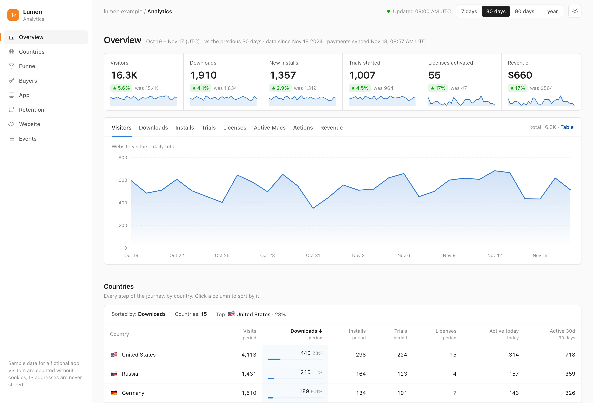
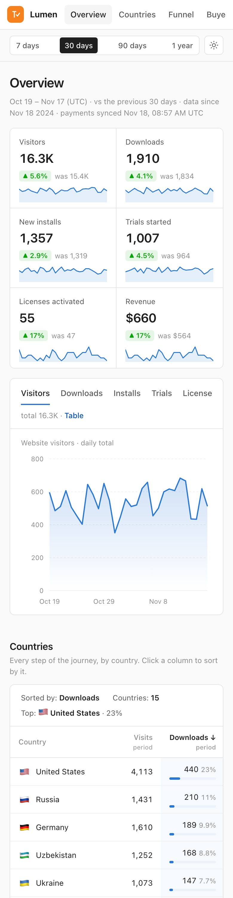
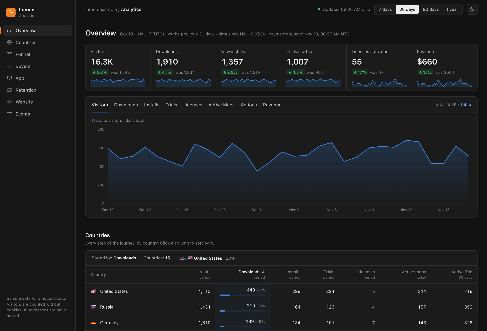

# Layout



## The frame

```
┌──────────┬──────────────────────────────────────────────────────────┐
│ ▣ Brand  │ crumbs / Analytics        ● Updated 09:00 UTC [7|30|90|1y] ◐ │  ← sticky top bar, 56 px
│          ├──────────────────────────────────────────────────────────┤
│ Overview │  Overview   Oct 19 – Nov 17 (UTC) · vs previous 30 days …  │
│ Countries│  ┌ KPI row ──────────────────────────────────────────────┐ │
│ Funnel   │  └───────────────────────────────────────────────────────┘ │
│ Buyers   │  ┌ tabs ─────────────────────────────── total · Table ──┐  │
│ App      │  │ one chart                                             │ │
│ Retention│  └───────────────────────────────────────────────────────┘ │
│ Website  │  Countries …                                               │
│ Events   │                                                            │
│ privacy  │                                                            │
│ note     │                                                            │
└──────────┴──────────────────────────────────────────────────────────┘
  224 px      content: max 1280 px, 24 px top, 28 px sides
```

- **Sidebar** (224 px, sticky, full height): brand mark and product name, one link per section with a 16 px
  icon, and a one-sentence privacy note pinned to the bottom. The link for the section in view gets a hover fill
  and a 3 px brand-coloured bar on its left edge (scroll spy: the last section whose top is above 96 px).
- **Top bar** (56 px, sticky, translucent `color-mix(in srgb, var(--bg) 88%, transparent)` with an 8 px blur):
  breadcrumbs, then a spacer, then the freshness status (green dot + "Updated 09:00 UTC"; red dot + "Error"), the
  period segmented control, and a theme button cycling auto → light → dark.
- **Content**: one column, max 1280 px. Sections are 40 px apart. Each starts with an `h2` and one grey line
  that says what the section counts.

## Section order

The order is the customer's journey, so the page reads like the funnel it describes:

1. **Overview** — the KPI row and one chart. Answers the first-glance question.
2. **Countries** — the whole journey per country, sortable.
3. **Funnel** — where people drop off, website then app.
4. **Buyers** — who paid, where they came from, how they used the trial.
5. **App** — active users, license status, trial days left, permissions, versions.
6. **Retention** — weekly install cohorts.
7. **Website** — referrers, campaigns, pages, countries, languages, devices.
8. **Events** — the latest 25 raw events, for "is tracking working right now?".

Put the money-related sections (overview revenue, buyers) above the operational ones (versions, events).

## Grids

- KPI rows: `repeat(var(--cols), minmax(0, 1fr))` with `--cols` set per row (6 for the overview, 5 for buyers,
  4 for the app). Always `minmax(0, 1fr)`, never `1fr`: a long number or label otherwise widens its column and
  pushes the page sideways on phones.
- Card grids: `.grid.three` and `.grid.two` with 16 px gaps. A grid of five cards in three columns leaves one
  empty slot; that is fine. Don't stretch the last card to fill it.
- Everything that can grow (tables) sits in an `overflow-x: auto` wrapper inside its card, so the page itself
  never scrolls sideways.

## Breakpoints

| Width | Changes |
|---|---|
| ≤ 1100 px | three-card grids become two; KPI rows become 3 columns |
| ≤ 900 px | sidebar becomes a sticky top strip with a horizontally scrolling section list (icons hidden, current section underlined); top bar wraps and stops being sticky; breadcrumbs hide; two-card grids become one; buyers grid stacks |
| ≤ 640 px | three-card grids become one; KPI rows become 2 columns; KPI values 21 px; the funnel bar moves under the label; the status hides; the period control stretches to the full width |



## Phone rules

- The section list scrolls sideways, but the page never does. Check `document.documentElement.scrollWidth ===
  clientWidth` at 390 px.
- Wide tables keep their first column (country) sticky so the row stays readable while the numbers scroll.
- Expanded timelines are `position: sticky; left: 34px` with a max width of `calc(100vw - 84px)`, so they stay
  in view when the table under them is scrolled sideways.
- Hide the freshness status rather than letting it wrap the header into three lines; the error banner still
  appears in the content.

## Dark mode

Follow the system by default (`prefers-color-scheme`), and let the theme button force light or dark with
`data-theme` on `<html>`. Define every colour as a token in both modes ([tokens.md](tokens.md)); a page that
looks right in dark mode only by accident will break the first time someone adds a hex colour.


